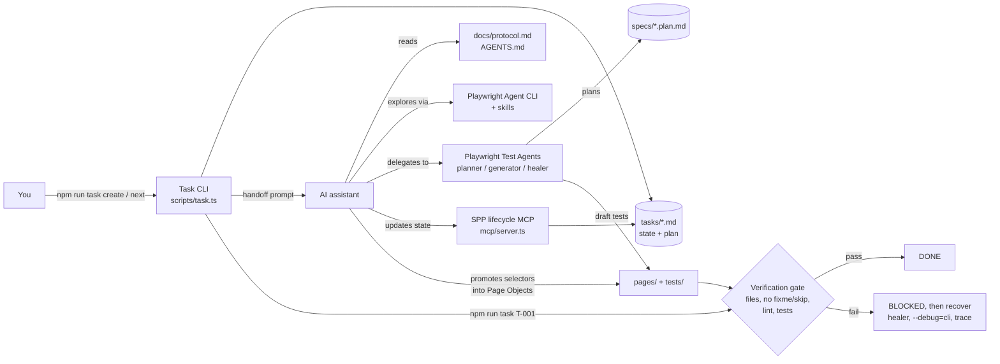

# ai-ts-playwright-protocol

Smart Playwright Protocol (SPP): a file-backed workflow for writing Playwright tests in TypeScript with an AI assistant, where every task passes the same verification gate before it counts as done.

[](https://github.com/yashwant-das/ai-ts-playwright-protocol/actions/workflows/verify.yml)
[](LICENSE)
[](https://playwright.dev)
[](https://www.typescriptlang.org)

## Why it exists

Playwright now ships its own agents: a token-efficient browser CLI, agent skills, and planner, generator and healer subagents. They write tests quickly, but the result is hard to review: there is no record of what was asked, generated tests put selectors inline, and a healer can quietly mark a test `fixme`. SPP wraps those agents in a contract. Each piece of work is a task file with a fixed lifecycle; agents explore, plan, generate and heal inside it; and a task only moves to `DONE` when the verification gate passes: selectors in Page Objects, lint clean, tests green, nothing skipped. The protocol, not the agent, decides when work is finished.

## Architecture



The task CLI hands a task to the assistant. The assistant explores with the Playwright CLI, has the planner write a test plan and the generator draft the test, then promotes every selector into a Page Object. The same CLI runs the gate that decides the task's final state, and the healer helps recover when it fails.

Every task follows one workflow:

```text
Select → Understand → Explore → Plan → Implement → Promote → Verify
                                                              ├─ PASS → DONE
                                                              └─ FAIL → BLOCKED → Recover → Verify
```

## Quickstart

Prerequisites: Node.js 24 (use the patch pinned in `.nvmrc`), and an AI assistant: Claude Code, VS Code / GitHub Copilot, Codex and OpenCode get ready-made Playwright Test Agents.

```bash
git clone https://github.com/yashwant-das/ai-ts-playwright-protocol.git && cd ai-ts-playwright-protocol
npm ci
npx playwright install chromium
cp .env.example .env     # BASE_URL defaults to https://www.saucedemo.com
npm run check
npm run test:smoke
npm test                # live Sauce Demo suite
```

The controlled smoke run reports two passing tests. A successful live run reports eight passing tests, including both seeds, against Sauce Demo. To work through a task with an assistant:

```bash
npm run task create      # interactive wizard, writes tasks/T-XXX_*.md
npm run task next        # moves a task to IN_PROGRESS and copies the handoff prompt
# paste the prompt into your assistant; it follows docs/protocol.md
npm run task T-001       # runs the verification gate for that task
```

The Playwright agents, skills and MCP configuration are committed, so they work out of the box. After upgrading Playwright, run `npm run agents` to regenerate them. Per-assistant setup notes are in [docs/development.md](docs/development.md#playwright-agent-tooling).

## Test reports and results

- `npm run check`: offline lint, format, types, config/text validation, selector checks and unit tests; no browser or secrets required.
- `npm run test:smoke`: two controlled Chromium tests against a loopback fixture; no public website access.
- `npm test`: the eight live Sauce Demo tests. `npm run task <TASK_ID>` runs that task's completion gate and can update its state.
- CI runs the offline checks, collects the live suite and executes controlled smoke tests on pushes and PRs to `main`.
- `npx playwright show-report` opens the last live HTML report. Smoke reports are in `playwright-report/smoke`; CI retains failures for three days.

The tests run against the public Sauce Demo site, so each failing test is retried once and a trace is kept for the retry.

## Tech stack

| Layer | Tool | Version | Why |
| --- | --- | --- | --- |
| Test runner | Playwright Test | 1.64 | Auto-waiting locators, traces and an HTML report out of the box |
| Agent tooling | Playwright Agent CLI, Test Agents, skills | 1.64 (bundled) | Token-efficient exploration, planning, generation and healing |
| Language | TypeScript | 6.0 | Typed page objects and task schemas |
| Task CLI | ts-node, @clack/prompts | 10.9, 1.8 | Interactive task creation and state changes |
| Assistant tooling | Model Context Protocol SDK | 1.32 | Exposes the task lifecycle to the assistant |
| Schema validation | zod | 4.6 | Validates MCP tool inputs |
| Quality gates | ESLint, Prettier, markdownlint-cli2, Husky, lint-staged | 10, 3, 0.24, 9, 17 | Staged hooks, offline checks and controlled browser CI |

## Project structure

```text
├── docs/            # protocol.md (source of truth), development.md, roadmap.md
├── tasks/           # One Markdown file per task, with state and context
├── specs/           # Test plans (planner output), linked from tasks
├── pages/           # Page objects, including Components/
├── tests/           # Playwright specs, fixtures.ts and seed tests
├── scripts/         # Task CLI, verification gate, agent regeneration, selector checker
├── mcp/             # SPP lifecycle MCP server
├── types/           # Task types
├── .claude/ .github/agents/ .codex/ .opencode/ .agents/
│                    # Generated Playwright agents and skills (npm run agents)
├── AGENTS.md        # Short instructions for AI assistants (CLAUDE.md imports it)
└── playwright.config.ts
```

## Usage

The task commands above create, activate and verify file-backed work. For command details, configuration and assistant setup, see the [development guide](docs/development.md).

## Documentation

- [docs/protocol.md](docs/protocol.md): workflow, states and rules
- [docs/development.md](docs/development.md): command reference, agent and MCP setup, troubleshooting
- [docs/roadmap.md](docs/roadmap.md): planned improvements
- [AGENTS.md](AGENTS.md): instructions for AI assistants

## License

MIT. See [LICENSE](LICENSE).
