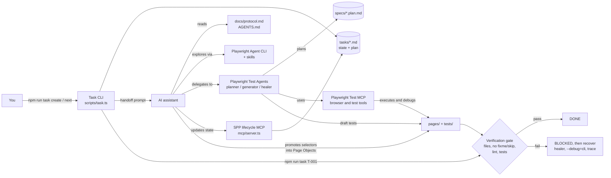

# Smart Playwright Protocol (SPP)

AI-assisted Playwright testing through an interactive TypeScript CLI, with agent skills, MCP tools, Page Objects and task-level verification.

[](https://github.com/yashwant-das/ai-ts-playwright-protocol/actions/workflows/verify.yml)
[](LICENSE)
[](https://playwright.dev)
[](https://www.typescriptlang.org)

## Why it exists

AI-generated tests need a clear link to the requested behavior, maintainable selectors and a repeatable way to verify the result. Smart Playwright Protocol gives that work a file-backed lifecycle: understand the requirement, explore the app, plan scenarios, generate tests, promote selectors into Page Objects, then verify and recover from failures.

SPP builds on Playwright's [planner, generator and healer agents](https://playwright.dev/docs/test-agents). Browser and trace skills guide the assistant's exploration and debugging. MCP tools give agents access to browser/test operations and let a configured assistant manage SPP tasks through the same verification gate as the CLI.

## What this demonstrates

| Engineering capability | Implementation in this repository |
| --- | --- |
| Interactive developer workflow | A [TypeScript CLI](scripts/task.ts) built with `@clack/prompts`: task menu, creation wizard, status board, clipboard handoff and guided verification/recovery output |
| AI-assisted test development | Version-matched planner, generator and healer [agent definitions](.github/agents/) for turning requirements into plans, executable tests and repair attempts |
| Agent skills for exploration and debugging | Committed [playwright-cli](.agents/skills/playwright-cli/SKILL.md) and [playwright-trace](.agents/skills/playwright-trace/SKILL.md) skills covering browser sessions, locator generation and trace investigation |
| MCP integration | Playwright Test MCP supplies browser/test tools to the agents; the TypeScript [SPP lifecycle MCP server](mcp/server.ts) exposes task creation, activation, verification, board listing and dependency queries |
| Maintainable test architecture | Typed [Page Objects](pages/), ARIA-first locators and [shared fixtures](tests/fixtures.ts), with business assertions in the specs |
| Traceable work and repeatable verification | Markdown [tasks](tasks/) linked to [test plans](specs/), a shared CLI/MCP gate, staged quality checks and controlled Chromium CI |

## Interactive CLI

Run `npm run task` in a terminal to open the menu: activate or resume work, verify
the active task, view the board, inspect blocked tasks or create a task through
the guided wizard. You can also go directly to a task with `npm run task <TASK_ID>`.

Activation excerpt for a task in `TODO`:

```text
❯ npm run task T-005
┌   SPP  Smart Playwright Protocol v3.0.0
│
●  T-005 Verify Footer Social Links TODO · activate
│
◆  T-005 TODO → IN PROGRESS
│
●  Handoff prompt · copied to clipboard ✓

Read docs/protocol.md

Task: T-005 Verify Footer Social Links
Task file: tasks/T-005_Footer.md
```

The printed prompt continues with the protocol steps and the verification command.
Paste it into your AI assistant, then run the task command again when the test is
ready. Verification shows each gate's progress and result; failures include error
excerpts and a recovery prompt. The CLI prints the handoff even when clipboard
access is unavailable and uses plain output without interactive prompts when
piped or run in CI. See the [CLI reference](docs/development.md#interactive-and-non-interactive-output)
for command behavior.

## Architecture



The assistant uses Playwright skills and agents to explore the application, produce a scenario plan and generate tests. Page Objects and fixtures provide the shared test architecture. The healer and trace skill support failure investigation, while the verification gate records the task result.

The two MCP integrations serve different roles: **Playwright Test MCP** provides the agents' browser and test tools; **SPP lifecycle MCP** exposes the repository's task workflow to a configured assistant. The CLI offers the same task operations through terminal commands. See the [protocol guide](docs/protocol.md) for component boundaries and the [development guide](docs/development.md#playwright-agent-tooling) for assistant setup.

Every task follows one workflow:

```text
Select → Understand → Explore → Plan → Implement → Promote → Verify
                                                              ├─ PASS → DONE
                                                              └─ FAIL → BLOCKED → Recover → Verify
```

## Quickstart

Prerequisites: Node.js 24 (use the patch pinned in `.nvmrc`), and an AI assistant: Claude Code, VS Code / GitHub Copilot, Codex and OpenCode get ready-made Playwright Test Agents.

```bash
git clone https://github.com/yashwant-das/ai-ts-playwright-protocol.git && cd ai-ts-playwright-protocol
npm ci
npx playwright install chromium
cp .env.example .env     # BASE_URL defaults to https://www.saucedemo.com
npm run check
npm run test:smoke
npm test                # live Sauce Demo suite
```

The controlled smoke run reports two passing tests. A successful live run reports eight passing tests, including both seeds, against Sauce Demo. To work through a task with an assistant:

```bash
npm run task create      # interactive wizard, writes tasks/T-XXX_*.md
npm run task next        # activates or resumes the next eligible task
# paste the prompt into your assistant; it follows docs/protocol.md
npm run task T-001       # runs the verification gate for that task
```

Playwright agent definitions and skills are committed for the supported assistants. Configure your assistant using the [setup notes](docs/development.md#playwright-agent-tooling); Codex and the GitHub Copilot coding agent need MCP setup outside the committed project files. After upgrading Playwright, run `npm run agents` to regenerate the definitions and skills.

## Test reports and results

- `npm run check`: offline lint, format, types, config/text validation, selector checks and unit tests; no browser or secrets required.
- `npm run test:smoke`: two controlled Chromium tests against a loopback fixture; no public website access.
- `npm test`: the eight live Sauce Demo tests. `npm run task <TASK_ID>` runs that task's completion gate and can update its state.
- CI runs the offline checks, collects the live suite and executes controlled smoke tests on pushes and PRs to `main`.
- `npx playwright show-report` opens the last live HTML report. Smoke reports are in `playwright-report/smoke`; CI retains failures for three days.

The task gate checks declared files and skip/fixme source patterns, runs lint and executes the task's test file. Acceptance-criteria coverage and assertion quality remain part of review; [gate details](docs/protocol.md#phase-7--verify) describe the automated checks.

The live suite targets public Sauce Demo by default; `BASE_URL` can override it. Locally, failing live tests get one retry; with `CI` set, they get two. A trace is captured on the first retry. Controlled smoke tests use the loopback fixture, have no retries and retain a trace on failure.

## Tech stack

Versions below match the committed [package manifest](package.json), [lockfile](package-lock.json) and [runtime pin](.nvmrc).

| Layer | Tool | Version | Why |
| --- | --- | --- | --- |
| Runtime | Node.js | 24.22.1 | Shared local and CI baseline |
| Test runner | Playwright Test | 1.64.1 | Auto-waiting locators, traces and an HTML report out of the box |
| Agent tooling | Playwright Agent CLI, Test Agents, skills | 1.64.1 (bundled) | Browser exploration, scenario planning, test generation and failure investigation |
| Language | TypeScript | 6.0.3 | Typed page objects and task schemas |
| Task CLI | ts-node, @clack/prompts | 10.9.2, 1.8.1 | Interactive task creation and state changes |
| MCP integration | Playwright Test MCP; Model Context Protocol SDK | 1.64.1; 1.32.2 | Browser/test tools for agents; SPP task tools for assistants |
| Schema validation | zod | 4.6.7 | Validates MCP tool inputs |
| Quality gates | ESLint, Prettier, markdownlint-cli2, Husky, lint-staged | 10.13.0, 3.9.10, 0.24.0, 9.1.7, 17.6.0 | Staged hooks, offline checks and controlled browser CI |

## Project structure

```text
├── docs/            # protocol.md (source of truth), development.md, roadmap.md
├── tasks/           # One Markdown file per task, with state and context
├── specs/           # Test plans (planner output), linked from tasks
├── pages/           # Page objects, including Components/
├── tests/           # Live specs, fixtures and seeds; unit/ and controlled smoke/
├── scripts/         # Task CLI, verification gate, agent regeneration, selector/text checks
├── mcp/             # SPP lifecycle MCP server
├── types/           # Task types
├── .claude/ .github/agents/ .codex/ .opencode/ .agents/
│                    # Generated Playwright agents and skills (npm run agents)
├── AGENTS.md        # Short instructions for AI assistants (CLAUDE.md imports it)
├── playwright.config.ts       # Live suite
└── playwright.smoke.config.ts  # Controlled loopback suite
```

## Usage

Use `npm run task` for the interactive menu, `npm run task create` for the creation wizard and `npm run task status` for the task board. For task selection, verification, configuration and assistant setup, see the [development guide](docs/development.md).

## Documentation

- [docs/protocol.md](docs/protocol.md): workflow, states and rules
- [docs/development.md](docs/development.md): command reference, agent and MCP setup, troubleshooting
- [docs/roadmap.md](docs/roadmap.md): planned improvements
- [AGENTS.md](AGENTS.md): instructions for AI assistants

## License

MIT. See [LICENSE](LICENSE).
