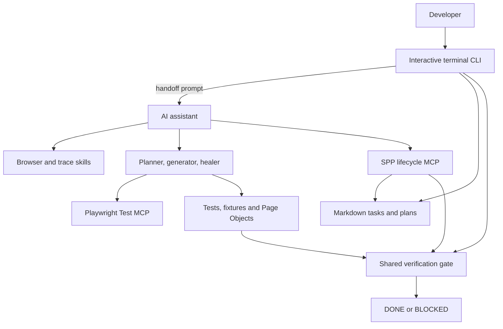

# Smart Playwright Protocol (SPP)

An interactive terminal CLI for AI-assisted Playwright testing, combining agents, browser and trace skills, Model Context Protocol (MCP) tools and task verification.

[](https://github.com/yashwant-das/ai-ts-playwright-protocol/actions/workflows/verify.yml)
[](LICENSE)
[](https://playwright.dev)
[](https://www.typescriptlang.org)

## Why it exists

AI-generated tests need a clear link to the requested behavior, maintainable selectors and a repeatable way to verify the result. SPP records the requirement and acceptance criteria in a Markdown task, links the test plan and implementation, and runs a shared completion gate.

It builds on Playwright's [planner, generator and healer agents](https://playwright.dev/docs/test-agents). The assistant uses browser and trace skills to explore and debug, promotes generated selectors into Page Objects, and verifies the task through the terminal CLI or lifecycle MCP tools.

## What this demonstrates

| Engineering capability | Implementation in this repository |
| --- | --- |
| Interactive developer workflow | A [terminal CLI written in TypeScript](scripts/task.ts) built with `@clack/prompts`: task menu, creation wizard, status board, clipboard handoff and guided verification/recovery output |
| AI-assisted test development | Version-matched planner, generator and healer [agent definitions](.github/agents/) for turning requirements into plans, executable tests and repair attempts |
| Agent skills for exploration and debugging | Committed [playwright-cli](.agents/skills/playwright-cli/SKILL.md) and [playwright-trace](.agents/skills/playwright-trace/SKILL.md) skills covering browser sessions, locator generation and trace investigation |
| MCP integration | Playwright Test MCP supplies browser/test tools to the agents; the TypeScript [SPP lifecycle MCP server](mcp/server.ts) exposes task creation, activation, verification, board listing and dependency queries |
| Maintainable test architecture | Typed [Page Objects](pages/), ARIA-first locators and [shared fixtures](tests/fixtures.ts), with business assertions in the specs |
| Traceable work and repeatable verification | Markdown [tasks](tasks/) linked to [test plans](specs/), a shared CLI/MCP gate, staged quality checks and controlled Chromium CI |

## Interactive CLI

Run `npm run task` in a terminal. Use the arrow keys to choose an action and Enter to confirm:

```text
❯ npm run task
┌   SPP  Smart Playwright Protocol v3.0.0
│
◆  What would you like to do?
│  ● Activate or resume next task
│  ○ Verify current active task
│  ○ Show task board
│  ○ Show blocked tasks
│  ○ Create a new task
│  ↑/↓ to navigate • Enter: confirm
└
```

The creation wizard validates task IDs and collects the requirement details. The board shows task states, block reasons and a suggested next command. Activating a task prints the protocol handoff and copies it to the clipboard when available. Verification reports gate progress and results; failures include error excerpts and recovery guidance.

## Architecture



Playwright Test MCP supplies browser and test tools to the agents. SPP lifecycle MCP exposes task creation, activation, verification, board listing and dependency queries. Both SPP interfaces use the shared gate; the assistant works from the task and its scenario plan. The [protocol guide](docs/protocol.md) covers the full lifecycle and component boundaries.

### Tech stack

Exact dependency versions are in the [manifest](package.json) and [lockfile](package-lock.json); the runtime is pinned in [.nvmrc](.nvmrc).

| Layer | Tool | Version | Purpose |
| --- | --- | --- | --- |
| Runtime | Node.js | 24.22.1 | Local and CI baseline |
| Browser automation | Playwright Test, CLI, agents and skills | 1.64.1 | Exploration, test execution, generation and debugging |
| Language | TypeScript | 6.0.3 | Typed tests, Page Objects and task tooling |
| Interactive terminal | @clack/prompts | 1.8.1 | Menus, wizard prompts, progress and results |
| CLI execution | ts-node | 10.9.2 | Runs the TypeScript task entrypoint |
| Lifecycle MCP | Model Context Protocol SDK | 1.32.2 | Exposes SPP task tools to assistants |
| Input validation | zod | 4.6.7 | MCP tool schemas |
| Code lint | ESLint | 10.13.0 | Type-aware and Playwright rules |
| Formatting | Prettier | 3.9.10 | Consistent code/config formatting |
| Markdown lint | markdownlint-cli2 | 0.24.0 | Maintained documentation checks |
| Git hooks | Husky | 9.1.7 | Installs repository hooks |
| Staged checks | lint-staged | 17.6.0 | Runs checks on staged files |

### Project structure

```text
├── docs/                       # Protocol, development guide and roadmap
├── tasks/                      # Task objectives, criteria, dependencies and state
├── specs/                      # Scenario plans linked to tasks
├── pages/                      # Page Objects and shared components
├── tests/                      # Live specs, fixtures, seeds, unit/ and smoke/
├── scripts/                    # Task CLI, gate, agent regeneration and checks
├── mcp/                        # SPP lifecycle MCP server
├── types/                      # Task types
├── .claude/ .github/agents/ .codex/ .opencode/ .agents/
│                               # Generated agent definitions and skills
├── AGENTS.md                   # Agent instructions; imported by CLAUDE.md
├── playwright.config.ts        # Live suite
└── playwright.smoke.config.ts  # Controlled loopback suite
```

## Quickstart

Use the Node.js version in `.nvmrc`. The AI workflow supports Claude Code, VS Code / GitHub Copilot, Codex and OpenCode; follow the [assistant setup](docs/development.md#playwright-agent-tooling) for the chosen integration.

```bash
git clone https://github.com/yashwant-das/ai-ts-playwright-protocol.git
cd ai-ts-playwright-protocol
npm ci
npx playwright install chromium
cp .env.example .env
npm run test:smoke
```

The controlled smoke run reports two passing Chromium tests against a local fixture.

## Usage

```bash
npm run task             # interactive menu
npm run task create      # guided creation wizard
npm run task status      # task board
npm run task T-005       # activate a TODO task, or verify an existing task
```

When a task is activated, paste the handoff prompt into your assistant. It follows the protocol: understand, explore, plan, implement and promote. Run the task command again when the test is ready to verify. The CLI offers a DONE confirmation in a terminal; non-interactive verification records DONE automatically after the gate passes.

Run `npm run agents` after a Playwright upgrade to regenerate the committed definitions and skills. The [development guide](docs/development.md) covers task selection, assistant configuration and recovery.

## Verification and reports

| Command | What it verifies |
| --- | --- |
| `npm run check` | Offline lint, formatting, types, text/config validation, selector health and 16 unit tests |
| `npm run test:smoke` | Two controlled Chromium checks using existing Page Objects and fixtures |
| `npm test` | Eight live tests against Sauce Demo by default, including both seeds |
| `npm run task <TASK_ID>` | Declared files and skip/fixme source patterns, lint and the task's test file; updates task state |

CI runs the offline checks, live-suite collection and controlled smoke on pushes and PRs to `main`. Live tests use `BASE_URL` (default `https://www.saucedemo.com`) and run separately. Acceptance-criteria coverage and assertion quality remain part of review; see [gate boundaries](docs/protocol.md#phase-7--verify).

Use `npx playwright show-report` for the live HTML report or `npx playwright show-report playwright-report/smoke` for the controlled report. Reports and results are ignored locally; CI retains smoke failure artifacts for three days. Retry and trace settings are in the [development guide](docs/development.md#quality-checks).

## Documentation

- [Protocol](docs/protocol.md): architecture, lifecycle, test rules and completion contract
- [Development](docs/development.md): setup, interactive CLI, skills, MCP integrations and troubleshooting
- [Roadmap](docs/roadmap.md): pending work and non-goals
- [Agent instructions](AGENTS.md): operating rules for assistants

## License

MIT. See [LICENSE](LICENSE).
