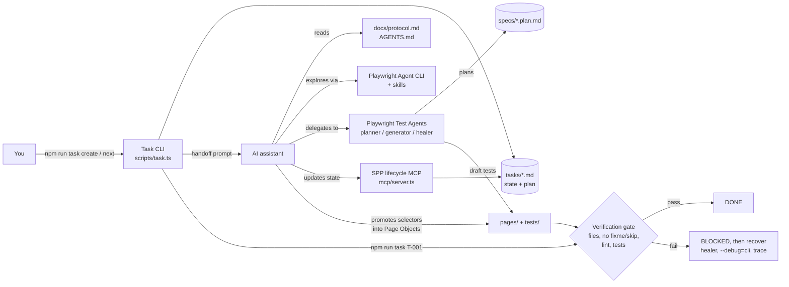

# Smart Playwright Protocol (SPP)

A workflow for AI-assisted Playwright testing with file-backed tasks, Page Objects and a shared verification gate.

[](https://github.com/yashwant-das/ai-ts-playwright-protocol/actions/workflows/verify.yml)
[](LICENSE)
[](https://playwright.dev)
[](https://www.typescriptlang.org)

## Why it exists

Playwright provides [planner, generator and healer agents](https://playwright.dev/docs/test-agents): the planner writes Markdown plans, the generator creates tests, and the healer repairs failures or marks a test to skip. SPP adds task state and project rules around those tools. Each task records its objective, acceptance criteria, test file and optional plan.

Generated tests are promoted into Page Objects before the shared CLI/MCP gate checks declared files, scans the declared test source for skip/fixme calls, runs lint and executes that test file. Passing checks allow the task to move to `DONE`. Acceptance-criteria coverage and assertion quality still need review.

## Architecture



The task CLI prints a handoff prompt and attempts to copy it to the clipboard. You give that prompt to your configured assistant, which can use Playwright's CLI and agents to explore, plan, generate and repair tests. SPP requires selectors in Page Objects. The task CLI and optional lifecycle MCP server run the same completion checks; neither starts an AI assistant automatically.

Every task follows one workflow:

```text
Select → Understand → Explore → Plan → Implement → Promote → Verify
                                                              ├─ PASS → DONE
                                                              └─ FAIL → BLOCKED → Recover → Verify
```

## Quickstart

Prerequisites: Node.js 24 (use the patch pinned in `.nvmrc`), and an AI assistant: Claude Code, VS Code / GitHub Copilot, Codex and OpenCode get ready-made Playwright Test Agents.

```bash
git clone https://github.com/yashwant-das/ai-ts-playwright-protocol.git && cd ai-ts-playwright-protocol
npm ci
npx playwright install chromium
cp .env.example .env     # BASE_URL defaults to https://www.saucedemo.com
npm run check
npm run test:smoke
npm test                # live Sauce Demo suite
```

The controlled smoke run reports two passing tests. A successful live run reports eight passing tests, including both seeds, against Sauce Demo. To work through a task with an assistant:

```bash
npm run task create      # interactive wizard, writes tasks/T-XXX_*.md
npm run task next        # activates or resumes the next eligible task
# paste the prompt into your assistant; it follows docs/protocol.md
npm run task T-001       # runs the verification gate for that task
```

Playwright agent definitions and skills are committed for the supported assistants. Configure your assistant using the [setup notes](docs/development.md#playwright-agent-tooling); Codex and the GitHub Copilot coding agent need MCP setup outside the committed project files. After upgrading Playwright, run `npm run agents` to regenerate the definitions and skills.

## Test reports and results

- `npm run check`: offline lint, format, types, config/text validation, selector checks and unit tests; no browser or secrets required.
- `npm run test:smoke`: two controlled Chromium tests against a loopback fixture; no public website access.
- `npm test`: the eight live Sauce Demo tests. `npm run task <TASK_ID>` runs that task's completion gate and can update its state.
- CI runs the offline checks, collects the live suite and executes controlled smoke tests on pushes and PRs to `main`.
- `npx playwright show-report` opens the last live HTML report. Smoke reports are in `playwright-report/smoke`; CI retains failures for three days.

The live suite targets public Sauce Demo by default; `BASE_URL` can override it. Locally, failing live tests get one retry; with `CI` set, they get two. A trace is captured on the first retry. Controlled smoke tests use the loopback fixture, have no retries and retain a trace on failure.

## Tech stack

Versions below match the committed [package manifest](package.json), [lockfile](package-lock.json) and [runtime pin](.nvmrc).

| Layer | Tool | Version | Why |
| --- | --- | --- | --- |
| Runtime | Node.js | 24.22.1 | Shared local and CI baseline |
| Test runner | Playwright Test | 1.64.1 | Auto-waiting locators, traces and an HTML report out of the box |
| Agent tooling | Playwright Agent CLI, Test Agents, skills | 1.64.1 (bundled) | Browser exploration, planning, generation and healing |
| Language | TypeScript | 6.0.3 | Typed page objects and task schemas |
| Task CLI | ts-node, @clack/prompts | 10.9.2, 1.8.1 | Interactive task creation and state changes |
| Assistant tooling | Model Context Protocol SDK | 1.32.2 | Exposes the task lifecycle to the assistant |
| Schema validation | zod | 4.6.7 | Validates MCP tool inputs |
| Quality gates | ESLint, Prettier, markdownlint-cli2, Husky, lint-staged | 10.13.0, 3.9.10, 0.24.0, 9.1.7, 17.6.0 | Staged hooks, offline checks and controlled browser CI |

## Project structure

```text
├── docs/            # protocol.md (source of truth), development.md, roadmap.md
├── tasks/           # One Markdown file per task, with state and context
├── specs/           # Test plans (planner output), linked from tasks
├── pages/           # Page objects, including Components/
├── tests/           # Live specs, fixtures and seeds; unit/ and controlled smoke/
├── scripts/         # Task CLI, verification gate, agent regeneration, selector/text checks
├── mcp/             # SPP lifecycle MCP server
├── types/           # Task types
├── .claude/ .github/agents/ .codex/ .opencode/ .agents/
│                    # Generated Playwright agents and skills (npm run agents)
├── AGENTS.md        # Short instructions for AI assistants (CLAUDE.md imports it)
├── playwright.config.ts       # Live suite
└── playwright.smoke.config.ts  # Controlled loopback suite
```

## Usage

The task commands above create, activate and verify file-backed work. For command details, configuration and assistant setup, see the [development guide](docs/development.md).

## Documentation

- [docs/protocol.md](docs/protocol.md): workflow, states and rules
- [docs/development.md](docs/development.md): command reference, agent and MCP setup, troubleshooting
- [docs/roadmap.md](docs/roadmap.md): planned improvements
- [AGENTS.md](AGENTS.md): instructions for AI assistants

## License

MIT. See [LICENSE](LICENSE).
