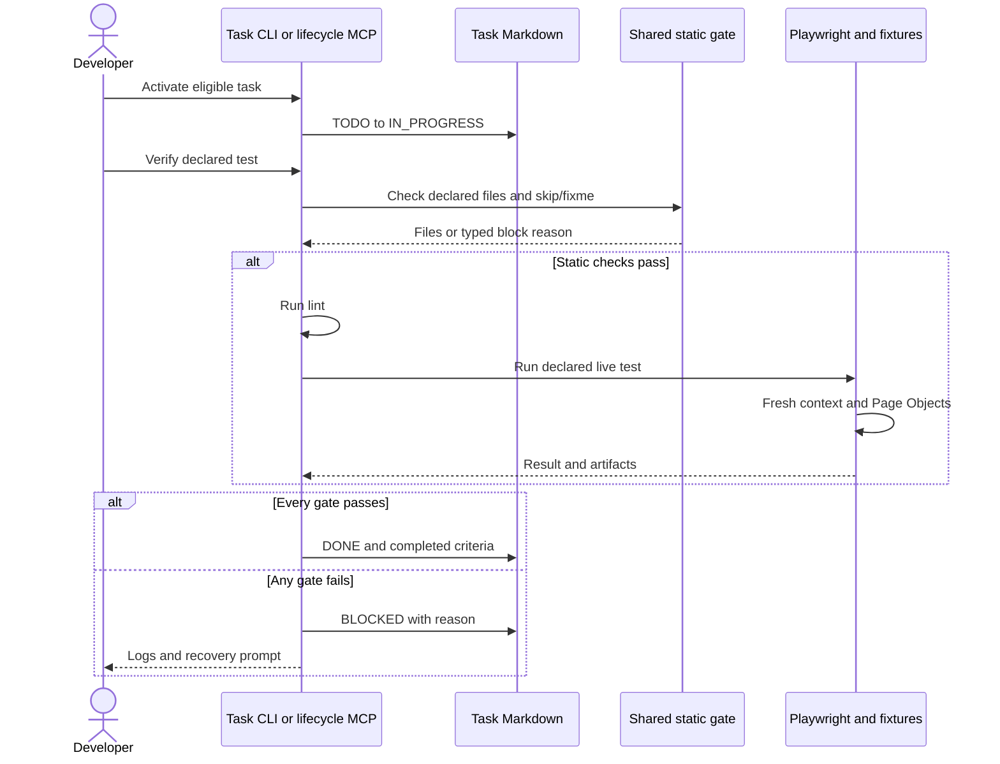

# Smart Playwright Protocol (SPP) v3.0.0

SPP defines the lifecycle and completion contract for AI-assisted Playwright tests. The task records the requested behavior and acceptance criteria; Playwright's agents and skills support exploration, planning, generation and recovery. Human review establishes whether the result meets the requirement.

## Scope

Included: file-backed tasks and plans, a terminal CLI, lifecycle MCP tools, Page Objects/fixtures and verification gates. Work assumes one active task and one writer. SPP does not provide a task database, cloud tracker, Jira/Slack integration, custom agent framework, vector store or AI memory system.

## Architecture

### Execution boundaries

The CLI and lifecycle MCP server share file checks and status writes through
`scripts/gate.ts`. Each interface runs lint and the declared live Playwright test
before recording DONE. Task state remains in Markdown; logs and browser artifacts
are local ignored output. SPP does not provision a hosted database or call an
LLM API itself; any AI-service usage belongs to the chosen assistant.

Playwright creates a fresh browser context per test. Fixtures construct Page
Objects in that context; `loggedInPage` authenticates before yielding the inventory
Page Object. The live suite contacts the configured `BASE_URL` (Sauce Demo by
default). Controlled CI smoke tests use a separate loopback server and block
non-loopback requests; they prove fixture/Page Object wiring, not Sauce Demo behavior.



File-backed state makes tasks reviewable but assumes one active task and one
writer. Playwright supplies agent capabilities; SPP retains the completion contract.
Local controlled tests keep PR checks deterministic; public-site runs remain a
separate compatibility check.

### Core Components

| Component | Responsibility |
| --- | --- |
| `docs/protocol.md` | Workflow, task states, quality rules and completion contract |
| `tasks/*.md` | Objective, business context, acceptance criteria, dependencies, state, test file and optional plan link |
| `specs/*.plan.md` | Scenario steps and expected outcomes; one optional plan per task |
| `scripts/task.ts` | Interactive creation, activation, verification, board and handoff/recovery prompts |
| `scripts/gate.ts` | Shared declared-file checks, skip/fixme source scan and status writes |
| `mcp/server.ts` | Optional lifecycle tools: create, activate, verify, list tasks and query unmet dependencies |

### Playwright tools and skills

Everything Playwright provides for agents, version-matched to the installed `@playwright/test`:

| Tool | What it is | Used in |
| --- | --- | --- |
| `npx playwright cli` (Agent CLI) | Browser driver: `snapshot`, `find`, `click e15`, `generate-locator`, sessions, `show` dashboard | Explore, Promote, Recover |
| `npx playwright test --debug=cli` | Pauses a real test so the CLI can `attach` to it | Explore, Recover |
| `npx playwright trace` | Reads trace files from the terminal | Recover |
| Agent skills (`playwright-cli`, `playwright-trace`) | Instructions that teach assistants the CLI | All phases |
| Test Agents: planner, generator, healer | Subagents backed by `playwright run-test-mcp-server` | Plan, Implement, Recover |

Agent definitions and skills are generated by Playwright and committed for Claude Code, VS Code / Copilot, Codex and OpenCode. Regenerate them after every Playwright upgrade with `npm run agents`. Never hand-edit them; SPP rules are enforced by the gate, not by modifying agent prompts.

Playwright MCP (`npx playwright mcp`) remains a supported alternative for exploration.

### Seeds and Fixtures

- `tests/fixtures.ts` exposes Page Objects as fixtures (`loginPage`, `inventoryPage`, `sidebar`) plus `loggedInPage` (logged in as the standard user). Specs import `test` and `expect` from here.
- `tests/seed.spec.ts` is the default seed: the starting state (logged in) for the planner, the generator and `--debug=cli` sessions.
- `tests/seed.guest.spec.ts` is the seed for scenarios that start logged out.

Seeds also run in the normal suite as smoke tests.

## Workflow

### Phase 1 — Select

Choose the next eligible task.

```text
TODO → IN_PROGRESS
```

Requirements:

- Dependencies satisfied
- No other task in progress (one active task at a time)

### Phase 2 — Understand

Before implementation begins, complete the "Understanding" section in the task file:

```markdown
Feature:
Expected Behavior:
Business Outcome:
Risk:
```

Implementation never begins before this section is populated.

**Note:** Explicit user approval of the Understanding phase is not required to move on unless the task or the user requests it.

### Phase 3 — Explore

Validate assumptions against the real application.

Recommended: drive the app through the seed so custom setup (login, fixtures) applies.

```bash
PLAYWRIGHT_HTML_OPEN=never npx playwright test tests/seed.spec.ts --debug=cli   # in the background
npx playwright cli attach tw-XXXX                                               # session name from the output
npx playwright cli snapshot
npx playwright cli find "Add to cart"
```

Alternatives: let the planner agent explore (Phase 4), or use Playwright MCP.

Goal: understand the application, and review existing Page Objects, before modifying code.

### Phase 4 — Plan

Write a test plan to `specs/<TASK_ID>_<feature>.plan.md` and link it from the task:

```markdown
- **Spec:** `specs/T-011_checkout-tax.plan.md`
```

Recommended: ask the **planner** agent, giving it the task file and the seed. For example: "Plan the scenarios in tasks/T-011_checkout-tax.md using seed tests/seed.spec.ts, save to specs/T-011_checkout-tax.plan.md."

Rules:

- Every Acceptance Criterion must be covered by at least one `- expect:` outcome.
- Scenarios are independent and start from a seed.
- Keep the task's Implementation Plan to a few lines; the detail lives in the spec.

Small tasks may skip the spec file and keep a short plan in the task.

Plans are generated files and are excluded from markdownlint (`specs/*.plan.md`).

### Phase 5 — Implement

Write the test, by hand or with the **generator** agent, which turns the spec into test files and validates selectors live.

Treat generated tests as drafts. Direct selectors in specs must be promoted into Page Objects before verification.

### Phase 6 — Promote

Bring the implementation in line with the SPP architecture:

1. Move every selector into a Page Object (new or existing) with JSDoc metadata (`@selector`, `@strategy`, `@verified`). Use `npx playwright cli generate-locator <ref>` to get stable ARIA-first locators.
2. Move multi-step interactions into Page Object methods.
3. Import `test` and `expect` from `tests/fixtures.ts` and use Page Object fixtures; add new fixtures for new Page Objects.
4. Keep the `// spec:` and `// seed:` header comments the generator adds; they trace the test back to its plan.
5. Ensure assertions validate business outcomes from the Acceptance Criteria.
6. The gate verifies one test file per task. The generator writes one file per scenario, so merge the generated scenarios into the task's `- **Test File:**` (one `describe`, one `test` per scenario) and delete the drafts.

Lint rejects common direct `page.getBy*()`, `page.locator()` and selector-string `page.click('...')` calls in `.spec.ts` files. Page Object use, fixture imports, selector metadata and acceptance-criteria coverage remain project rules to review; the gate does not prove all of them.

### Phase 7 — Verify

```bash
npm run task <TASK_ID>
```

The gate runs, in order:

1. Static checks: the declared test file (and spec, if any) exists; the test file contains no `test.fixme()` or `test.skip()`.
2. `npm run lint`: ESLint (no raw locators in specs, no focused tests, no hard waits, typed code) and markdownlint.
3. The task's Playwright test file, with success determined by the command exit code.

The static scan checks skip/fixme call patterns in the declared test source; it
does not inspect every imported helper or runtime skip. The gate does not check
Understanding completeness, acceptance-criteria coverage or assertion semantics.
A successful status write checks off remaining acceptance boxes, so review those
criteria before verification rather than treating the checkboxes as independent
evidence. Full repository checks (`npm run check`) also include formatting, types
and unit tests; task verification runs `npm run lint`, not that full command.

Outcome:

```text
IN_PROGRESS → DONE
IN_PROGRESS → BLOCKED (blockReason: verification | regression)
```

### Phase 8 — Recover

When verification fails:

1. Read `logs/last_run.log`.
2. Find the root cause with evidence:
   - the **healer** agent, which replays the failing test, inspects the page and patches the test; or
   - `npx playwright test <file> --debug=cli`, then `npx playwright cli attach` to inspect the paused page; and/or
   - `npx playwright trace open <trace.zip>` for traces captured on retries.
3. Apply the smallest possible fix. Selector fixes go into Page Objects, not specs.
4. Re-run verification.

Agents may loop through steps 2–4 on their own. They may not mark the task `DONE`; only the gate does.

#### Regressions need a human

If the healer (or anyone) concludes the app, not the test, is wrong, it marks the test `test.fixme()` with a comment explaining why. The gate then blocks the task with `blockReason: regression`. A human decides:

- **App regression:** report the bug; the task stays `BLOCKED` until the app is fixed.
- **Intended change:** update the spec and the test, remove `test.fixme()`, re-verify.

Agents must not remove `test.fixme()` without that decision.

## Task States

Only four task states exist.

### TODO

Task has not started.

### IN_PROGRESS

Task is actively being worked on. Only one task may be in progress.

### BLOCKED

Task cannot continue or verification failed. The gate records the block reason.

#### Block Reason Definitions

| Block Reason | Meaning |
| --- | --- |
| `dependency` | Waiting on another task to be completed. |
| `requirement` | Missing clarification or business requirement. |
| `selector` | UI locator issue preventing progress. |
| `verification` | Static checks, lint or test failure. |
| `environment` | Tooling, infrastructure, browser, or setup issue. |
| `regression` | The test is marked `test.fixme()`: the app contradicts the spec. Needs a human decision. |

Example:

```yaml
status: BLOCKED
blockReason: regression
```

### DONE

Verification passed and all acceptance criteria are satisfied.

## Task Structure

```markdown
---
id: T-011
title: Verify Checkout Tax
status: TODO
dependsOn: []
---

## Understanding

Feature:
Expected Behavior:
Business Outcome:
Risk:

## Context

- **Page Object:** `pages/CheckoutPage.ts`
- **Test File:** `tests/checkout_tax.spec.ts`
- **URL:** `/checkout-step-two.html`
- **Spec:** `specs/T-011_checkout-tax.plan.md`

## Implementation Plan

1. Explore from the seed and save the plan to specs/
2. Implement the test
3. Promote selectors into Page Objects

## Acceptance Criteria

- [ ] Tax is 8% of the item total
- [ ] Total equals item total plus tax
```

`- **Spec:**` is optional. When present, the gate checks the file exists.

## Quality Gates

### Pre-Commit

Husky and lint-staged validate staged content using the same locked tools as CI. Markdown, formatter and config/text checks accompany the code rules below; see [development](development.md#quality-checks) for commands and exclusions.

- **lint-staged**: ESLint on changed files.
- **Selector Health Check**: ARIA-first locators in Page Objects; warns on `@verified` dates older than 90 days.
- **Focused Test Protection**: blocks `test.only()` and `describe.only()`.
- **Hard Wait Protection**: blocks `page.waitForTimeout()`.
- **Skipped Test Detection**: warns on `test.skip()`.

Task completion uses the gate in [Phase 7](#phase-7--verify). CI separately runs offline quality checks, live-suite collection and controlled Chromium smoke. Public-site tests run separately.

### Required Rules

#### Page Objects Own Selectors

SPP requires selectors in Page Objects with JSDoc metadata and specs that use Page Objects and fixtures. ESLint rejects common direct locator calls in specs; selector health rejects non-ARIA locator calls in Page Objects and warns on old verification dates. These checks do not establish that every property has metadata or that every spec imports the shared fixtures.

#### No Hard Waits

Disallow `page.waitForTimeout(...)` and `waitUntil: 'networkidle'`. Use web-first assertions and auto-waiting locators.

#### No Accidental Test Isolation

Disallow `test.only(...)` and `describe.only(...)`.

#### No Skipped or Fixme Tests in a DONE Task

`test.skip()` fails the gate. `test.fixme()` blocks the task as a `regression`.

#### Business Assertions Required

Every test must validate at least one business outcome from the task's acceptance criteria.

**Weak Assertion:**

```typescript
await expect(button).toBeVisible();
```

**Strong Business Assertions:**

```typescript
await expect(total).toHaveText("$54.99");
await expect(cartCount).toHaveText("3");
await expect(orderStatus).toContainText("Completed");
```

#### Agent Rules

- Agents may run inside any phase, including loops (explore, generate, heal), and may be chained.
- One task is active at a time; agents work within that task's scope.
- Only the verification gate moves a task to `DONE`.
- Agents never hand-edit generated agent definitions; regenerate with `npm run agents`.
- Agents stop and ask the user when a decision needs product knowledge (for example, a regression).

## Commit Conventions

### Format

```text
<type>(<optional-scope>): <subject>
```

### Supported Types

- **feat**: New feature or capability.
- **fix**: Bug fix or correction.
- **refactor**: Code change that neither fixes a bug nor adds a feature.
- **test**: Adding or updating tests.
- **docs**: Documentation changes.
- **chore**: Maintenance tasks, small cleanups.
- **build**: Dependencies, tooling, package, or infrastructure updates (including regenerated agents).
- **arch**: Architectural changes or protocol updates.
- **heal**: Selector repair or automation healing.
- **map**: Mapping application structures, test plans or architectural discovery.

### Examples

- `feat(cli): add task generator`
- `fix(tasks): handle blocked task parsing`
- `build(deps): upgrade playwright and regenerate agents`
- `heal(selectors): repair checkout locator`
- `map(checkout): add T-011 test plan`

## Completion requirements

Before verification, review acceptance criteria, business assertions, Page Object ownership and shared fixture use. A task is complete only after the gate passes and the reviewed behavior matches the requirement. Skipped/fixme tests require recovery or a human regression decision.

For setup, commands and troubleshooting, use the [development guide](development.md). Pending changes are in the [roadmap](roadmap.md); concise assistant instructions are in [AGENTS.md](../AGENTS.md).

## Agent Completion Protocol

The verification step is the final authority in SPP. AI assistants must not claim a task is complete unless verification has passed.

### 1. Ready for Verification

Use this response when implementation and promotion are finished but verification has not yet been executed.

```text
Task <TASK_ID> Ready for Verification
Summary:
✅ Spec: specs/<TASK_ID>_<feature>.plan.md
✅ Created <PageObject> with JSDoc
✅ Created <TestFile> verifying <Requirement>
✅ Selectors promoted to Page Objects; no raw locators in specs

Next Step:
Run:
npm run task <TASK_ID>
```

### 2. Complete Response

Use this response only when verification has passed.

```text
Task <TASK_ID> Complete ✓
Summary:
✅ Spec: specs/<TASK_ID>_<feature>.plan.md
✅ Created <PageObject> with JSDoc
✅ Created <TestFile> verifying <Requirement>
✅ Selectors promoted to Page Objects; no raw locators in specs
✅ lint passed
✅ tests passed
All acceptance criteria met.
Recommended Next Step:
Review the generated changes and commit if satisfied.
```

### 3. Blocked Response

Use this response when implementation cannot proceed or verification fails.

```text
Task <TASK_ID> Blocked (<blockReason>)
Summary:
- <What was attempted>
- <What failed or remains incomplete>
- <Relevant command that failed>

Recovery Required:
1. Review logs/last_run.log
2. Identify the root cause (healer agent, --debug=cli, or trace)
3. Apply the smallest possible fix
4. Retry:
npm run task <TASK_ID>
```

For `regression`, replace "Recovery Required" with the question the user must answer: is the app or the spec wrong?
